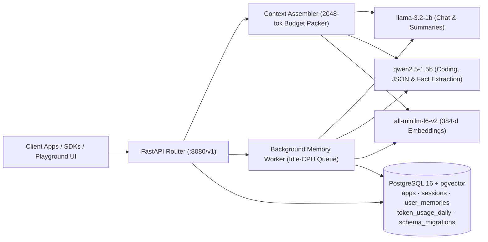

# Containerized Multi-Model `llama.cpp` API, Memory Router & Playground

Run multiple CPU-only `llama.cpp` (`llama-server`) models in Docker behind a single OpenAI-compatible REST & SSE streaming API (`http://localhost:8080/v1`) with:
- **Multi-Model & Virtual Agent Routing**: Route requests across `llama-3.2-1b`, `qwen2.5-1.5b`, `all-minilm-l6-v2`, and **8 zero-extra-RAM virtual agents** (`coder`, `code-reviewer`, `sql-assistant`, `json-extractor`, `summarizer`, `translator`, `classifier`, `general-assistant`).
- **Multi-Tenant Session & Semantic User Memory**: Backed by PostgreSQL 16 + `pgvector` and local `384`-d embeddings, with automatic rolling conversation compaction, background durable fact extraction, and strict `2048`-token context packing.
- **Integrated App Registration & API Keys (`ak_<app_id>_...`)**: Cryptographic `(app_id, user_id)` tenant isolation with a zero-friction `AUTH_MODE=dev` sandbox and `AUTH_MODE=strict` production guard.
- **App & User Token Usage Tracking**: Daily-rollup token accounting (`prompt_tokens`, `completion_tokens`, `total_tokens`, `request_count`) across direct API calls and background memory jobs (`memory_compact`, `memory_extract`, `memory_embed`).
- **Seamless Automatic Database Migrations**: Ordered, transactional SQL migrations (`router/db/migrations/*.sql`) applied automatically on startup under a PostgreSQL advisory lock.
- **Built-in Interactive Web UI Playground**: Test chat, streaming, virtual agents, embeddings similarity, and memory inspection at [`http://localhost:8080/playground`](http://localhost:8080/playground).

> **Full Integration & Agent Harness Guide**: See **[`docs/model-integration.md`](docs/model-integration.md)** for complete Python/TypeScript SDK examples, multi-stage `LocalModelHarness` / `AIModelHarness` pipelines, `X-Memory-Mode` rules, and local RAG recipes.

---

## Architecture



---

## Available Models & Virtual Agents

### Base Models
| Model ID | Type | Best For |
| --- | --- | --- |
| `llama-3.2-1b` *(default)* | Chat / Completion | Fast general chat, rolling summaries, classification, translation |
| `qwen2.5-1.5b` | Chat / Completion | Coding, code review, SQL generation, structured JSON & fact extraction |
| `all-minilm-l6-v2` | Embeddings (`384`-d) | Semantic memory recall, cosine similarity search, local RAG |

### Virtual Agents (Zero Extra RAM)
| Agent ID | Backend Model | Default Temp | Memory Extraction | Purpose |
| --- | --- | --- | --- | --- |
| `coder` | `qwen2.5-1.5b` | `0.2` | Yes | Clean, working code with brief explanations |
| `code-reviewer` | `qwen2.5-1.5b` | `0.2` | Yes | Identify bugs, security risks, edge cases, and improvements |
| `sql-assistant` | `qwen2.5-1.5b` | `0.1` | Yes | Accurate, safe SQL queries with brief schema assumptions |
| `json-extractor` | `qwen2.5-1.5b` | `0.0` | No | Deterministic JSON extraction without markdown fences |
| `summarizer` | `llama-3.2-1b` | `0.3` | No | Concise bullet-point summaries preserving key facts |
| `translator` | `llama-3.2-1b` | `0.2` | No | Accurate language translation preserving tone and meaning |
| `classifier` | `llama-3.2-1b` | `0.0` | No | Category or sentiment classification with a one-line reason |
| `general-assistant` | `llama-3.2-1b` | `0.7` | Yes | Helpful general-purpose conversational assistant |

For multi-stage orchestration patterns combining these agents, see **[`docs/model-integration.md`](docs/model-integration.md#building-an-agentic-application-harness)**.

---

## Quickstart

### 1. Configure `.env` & PostgreSQL (`pgvector`)
```bash
cp .env.example .env
```
Ensure `DATABASE_URL` points to your PostgreSQL 16 database with the `vector` (`pgvector`) extension enabled:
```bash
sudo -u postgres psql -d ai_models_db -c "CREATE EXTENSION IF NOT EXISTS vector;"
```
> **Seamless Migrations**: On startup, the router automatically acquires a PostgreSQL advisory lock, creates `schema_migrations`, and applies any pending SQL migrations in `router/db/migrations/*.sql` (`001_initial_schema.sql`, `002_token_usage_daily.sql`, etc.).

### 2. Download Default CPU-Friendly GGUF Models
```bash
chmod +x scripts/download-models.sh
./scripts/download-models.sh
```

### 3. Start the Stack
```bash
docker compose up -d --build
```

### 4. Open the UI Playground or Check Health
- **Browser Playground**: [`http://localhost:8080/playground`](http://localhost:8080/playground)
- **Health & Registered Models/Agents**:
  ```bash
  curl -s http://localhost:8080/health
  curl -s http://localhost:8080/v1/models
  ```

---

## App Registration & Flexible Authentication (`AUTH_MODE`)

- **`AUTH_MODE=dev` *(default)***:
  - Quick `curl` and SDK tests work immediately without an API key under `"dev-sandbox"` (or any unclaimed `X-App-Id`).
  - Registered apps **still enforce** their issued `ak_...` API key in `dev` mode so test calls can never spoof a registered app.
- **`AUTH_MODE=strict` *(production)***:
  - Every `/v1/*` call must provide a valid `Authorization: Bearer ak_<app_id>_...` key.

### Register an Integrated App (CLI, REST, or Playground UI)
```bash
# Via CLI
python3 scripts/manage_apps.py create --app-id crm-web --name "CRM Web App"
python3 scripts/manage_apps.py list

# Or via REST (from localhost in dev mode, or pass -H "X-Admin-Key: $ADMIN_API_KEY")
curl -s -X POST http://localhost:8080/v1/apps \
  -H "Content-Type: application/json" \
  -d '{"app_id": "crm-web", "name": "CRM Web App"}'
```

---

## Calling the API with Session & User Memory

### Stateful Multi-Turn Chat (`curl`)
Send only the latest user message per turn — the router automatically recalls long-term user facts, rolling summaries, and recent turns within the `2048`-token context budget:

```bash
curl -s http://localhost:8080/v1/chat/completions \
  -H "Content-Type: application/json" \
  -H "Authorization: Bearer ak_crm-web_..." \
  -H "X-User-Id: user_42" \
  -H "X-Session-Id: sess_onboarding" \
  -d '{
    "model": "general-assistant",
    "messages": [{"role": "user", "content": "I build backend services in Python with FastAPI and PostgreSQL."}],
    "max_tokens": 128
  }'
```

### Python (`openai` SDK)
```python
from openai import OpenAI

client = OpenAI(
    base_url="http://localhost:8080/v1",
    api_key="ak_crm-web_...",  # or "not-needed" in AUTH_MODE=dev
)

resp = client.chat.completions.create(
    model="coder",
    user="user_42",
    extra_body={"session_id": "sess_onboarding", "memory_mode": "auto"},
    messages=[{"role": "user", "content": "Create a healthcheck endpoint matching my stack."}],
)
print(resp.choices[0].message.content)
```

---

## App & User Token Usage Tracking

The router tracks `prompt_tokens`, `completion_tokens`, `total_tokens`, and `request_count` in PostgreSQL (`token_usage_daily`), categorized by `model_id` and `source` (`chat`, `completion`, `embedding`, `memory_compact`, `memory_extract`, `memory_embed`).

```bash
# 1. Query usage for a specific user within the authenticated app (with model, source & daily breakdowns)
curl -s "http://localhost:8080/v1/usage?start_date=2026-01-01" \
  -H "Authorization: Bearer ak_crm-web_..." \
  -H "X-User-Id: user_42"

# 2. Query app-wide token usage across all users
curl -s http://localhost:8080/v1/usage \
  -H "Authorization: Bearer ak_crm-web_..."

# 3. List per-user token usage totals within the app
curl -s "http://localhost:8080/v1/usage/users?limit=50" \
  -H "Authorization: Bearer ak_crm-web_..."

# 4. Admin cross-app usage inspection (filterable by user_id, model_id, source, start_date, end_date)
curl -s "http://localhost:8080/v1/apps/crm-web/usage?source=chat" \
  -H "X-Admin-Key: ${ADMIN_API_KEY}"
```

---

## REST API Endpoints Summary

All tenant endpoints enforce strict `(app_id, user_id)` isolation:

| Category | Endpoints | Description |
| --- | --- | --- |
| **Health & Models** | `GET /health` · `GET /v1/models` | Backend health, DB migration count, worker queue depth, model/agent list |
| **Inference** | `POST /v1/chat/completions` · `POST /v1/completions` · `POST /v1/embeddings` | OpenAI-compatible chat (REST & SSE), raw completion, and `384`-d embeddings |
| **App Management** | `GET /v1/apps/me` · `POST /v1/apps` · `GET /v1/apps` · `POST /v1/apps/{id}/rotate-key` · `DELETE /v1/apps/{id}` | App self-inspection (with `token_usage`), registration, key rotation, revocation |
| **Token Usage** | `GET /v1/usage` · `GET /v1/usage/users` · `GET /v1/apps/{id}/usage` | App & user token totals, per-model/per-source/daily breakdowns, user usage list |
| **Sessions** | `POST /v1/sessions` · `GET /v1/sessions` · `GET /v1/sessions/{id}` · `POST /v1/sessions/{id}/compact` · `DELETE /v1/sessions/{id}` | Session lifecycle, message history inspection, and manual rolling-summary compaction |
| **Semantic Memories** | `POST /v1/memories` · `GET /v1/memories` · `POST /v1/memories/search` · `PATCH /v1/memories/{id}` · `DELETE /v1/memories/{id}` · `DELETE /v1/users/{id}/data` | Explicit fact CRUD, `pgvector` similarity search, and full user tenant data wipe |

### Custom Response Headers
Chat completion responses expose telemetry headers (CORS-exposed):
- `X-App-Id`: Resolved application tenant ID
- `X-Session-Id`: Active session ID (when bound)
- `X-Memories-Recalled`: Number of semantic user memories injected into context
- `X-Context-Tokens`: Assembled prompt token count within the `2048`-token window

---

## Local Development & Testing (`uv`)

Python dependencies are managed with [`uv`](https://docs.astral.sh/uv/) via `pyproject.toml`:

```bash
# Create/update .venv and sync dependencies
uv sync

# Run the deterministic unit & integration test suite
uv run pytest -v router/tests/
```

---

## Documentation
- **[Model & Memory Integration Guide (`docs/model-integration.md`)](docs/model-integration.md)** — Connection settings, multi-tenant header/SDK mapping, explicit memory CRUD, and production-ready Python & TypeScript agentic harnesses (`LocalModelHarness` / `AIModelHarness`).
