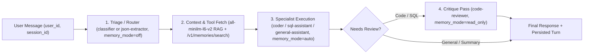

# Model & Memory Integration Guide

Use this guide to connect any backend, frontend, CLI, or mobile application to the local `llama.cpp` multi-model, virtual-agent & multi-tenant memory API.

## Connection Details

| Setting | Value |
| --- | --- |
| **UI Playground** | `http://localhost:8080/playground` |
| **Base URL (same machine)** | `http://localhost:8080/v1` |
| **Base URL (LAN / other device)** | `http://<HOST_IP>:8080/v1` |
| **Base URL (another Docker container)** | `http://host.docker.internal:8080/v1` |
| **App Authentication (`AUTH_MODE=dev`)** | Optional for sandbox testing (`api_key="not-needed"`), enforced for registered apps (`Bearer ak_<app>_...`) |
| **App Authentication (`AUTH_MODE=strict`)** | Mandatory registered `Authorization: Bearer ak_<app>_...` API key |
| **CORS** | Enabled (`*`), exposes `X-App-Id`, `X-Session-Id`, `X-Memories-Recalled`, `X-Context-Tokens` |

---

## Available Models & Virtual Agents

### Base Models
| ID | Type | Best For |
| --- | --- | --- |
| `llama-3.2-1b` *(default)* | Chat / Completion | Fast general text, rolling summaries, lightweight tasks |
| `qwen2.5-1.5b` | Chat / Completion | Coding, reasoning, structured JSON fact extraction |
| `all-minilm-l6-v2` | Embeddings (`384`-dim) | Semantic memory recall, similarity search, RAG |

### Virtual Agents (Zero Extra RAM)
| Agent ID | Backend | Default Temp | Purpose |
| --- | --- | --- | --- |
| `coder` | `qwen2.5-1.5b` | `0.2` | Clean, working code with brief explanations |
| `code-reviewer` | `qwen2.5-1.5b` | `0.2` | Bugs, security issues, edge cases, improvements |
| `sql-assistant` | `qwen2.5-1.5b` | `0.1` | Safe SQL queries and brief schema assumptions |
| `json-extractor` | `qwen2.5-1.5b` | `0.0` | Valid JSON extraction without markdown fences |
| `summarizer` | `llama-3.2-1b` | `0.3` | Concise bullet-point summaries |
| `translator` | `llama-3.2-1b` | `0.2` | Accurate language translation |
| `classifier` | `llama-3.2-1b` | `0.0` | Categorization / sentiment with one-line reason |
| `general-assistant` | `llama-3.2-1b` | `0.7` | General conversational assistant |

---

## Multi-Tenant Memory Architecture

Every session and semantic user fact is strictly isolated by **`(app_id, user_id)`** in PostgreSQL + `pgvector`:
- **App A** (`ak_app-a_...`) and **App B** (`ak_app-b_...`) never share sessions, summaries, or extracted user facts—even if both pass `"user": "user_123"`.
- Pass identity via headers **or** OpenAI SDK fields:

| Parameter | HTTP Header | OpenAI Body / `extra_body` | Notes |
| --- | --- | --- | --- |
| **App API Key** | `Authorization: Bearer ak_...` | `OpenAI(api_key="ak_...")` | Cryptographically binds `app_id` |
| **Sandbox App ID** | `X-App-Id` | `app_id` / `metadata.app_id` | Only for keyless testing in `AUTH_MODE=dev` |
| **User ID** | `X-User-Id` | `user` / `metadata.user_id` | Scopes sessions & semantic memories |
| **Session ID** | `X-Session-Id` | `session_id` / `metadata.session_id` | Persists turn-by-turn history + rolling summary |
| **Memory Mode** | `X-Memory-Mode` | `memory_mode` | `auto` (default), `read_only`, `session_only`, `off` |
| **Session TTL** | `X-Session-TTL-Hours` | `session_ttl_hours` | Optional auto-expiry in hours |

---

## Registering an Integrated App

### Option A: UI Playground
Open `http://localhost:8080/playground`, click **Manage Apps & Keys**, enter an `app_id` and name, and copy the one-time `ak_<app_id>_...` key.

### Option B: CLI Script
```bash
python3 scripts/manage_apps.py create --app-id my-saas --name "My SaaS App"
python3 scripts/manage_apps.py list
python3 scripts/manage_apps.py rotate-key --app-id my-saas
python3 scripts/manage_apps.py revoke --app-id my-saas
```

### Option C: Admin REST Endpoint
```bash
curl -s -X POST http://localhost:8080/v1/apps \
  -H "Content-Type: application/json" \
  -H "X-Admin-Key: ${ADMIN_API_KEY}" \
  -d '{"app_id": "my-saas", "name": "My SaaS App"}'
```

---

## Integration Examples

### 1. Python (`openai` SDK — Stateful Session + Semantic Recall)
```python
from openai import OpenAI

client = OpenAI(
    base_url="http://localhost:8080/v1",
    api_key="ak_my-saas_...",
)

# Turn 1: Save conversation turn + asynchronously extract durable user facts
client.chat.completions.create(
    model="general-assistant",
    user="user_99",
    extra_body={"session_id": "chat_001"},
    messages=[{"role": "user", "content": "I am a Rust backend developer targeting WebAssembly."}],
)

# Turn 2: Send ONLY the new user message — prior turns & facts are injected automatically!
reply = client.chat.completions.create(
    model="coder",
    user="user_99",
    extra_body={"session_id": "chat_001"},
    messages=[{"role": "user", "content": "Recommend a lightweight serialization crate for my setup."}],
)
print(reply.choices[0].message.content)
```

### 2. TypeScript / JavaScript (`fetch` with Headers)
```typescript
const BASE_URL = "http://localhost:8080/v1";

export async function sendSessionMessage(
  apiKey: string,
  userId: string,
  sessionId: string,
  prompt: string,
) {
  const res = await fetch(`${BASE_URL}/chat/completions`, {
    method: "POST",
    headers: {
      "Content-Type": "application/json",
      "Authorization": `Bearer ${apiKey}`,
      "X-User-Id": userId,
      "X-Session-Id": sessionId,
      "X-Memory-Mode": "auto",
    },
    body: JSON.stringify({
      model: "general-assistant",
      messages: [{ role: "user", content: prompt }],
      max_tokens: 256,
    }),
  });
  if (!res.ok) throw new Error(await res.text());
  return res.json();
}
```

### 3. Explicit Semantic Memory CRUD & Search
```bash
# Add a durable user preference directly
curl -s -X POST http://localhost:8080/v1/memories \
  -H "Content-Type: application/json" \
  -H "Authorization: Bearer ak_my-saas_..." \
  -H "X-User-Id: user_99" \
  -d '{"category": "preference", "importance": 5, "content": "Always respond in concise bullet points."}'

# Semantic search across a user's memories within this app
curl -s -X POST http://localhost:8080/v1/memories/search \
  -H "Content-Type: application/json" \
  -H "Authorization: Bearer ak_my-saas_..." \
  -H "X-User-Id: user_99" \
  -d '{"query": "response formatting style", "top_k": 5}'

# Delete all sessions & memories for a user in this app
curl -s -X DELETE http://localhost:8080/v1/users/user_99/data \
  -H "Authorization: Bearer ak_my-saas_..."
```

---

## Building an Agentic Application Harness

Small quantized CPU models (`1B–1.5B` with a `2048`-token window) perform dramatically better when orchestrated by a **structured harness** rather than stuffing classification, tool selection, RAG, generation, and validation into one giant prompt.

A harness decomposes each user request into focused stages—routing each stage to the best base model or virtual agent while controlling **`X-Memory-Mode`** so internal scratchpad calls never pollute the user's conversation history.

### 1. Reference Harness Pipeline



### 2. Memory-Mode Rules Inside a Harness

| Harness Stage | Recommended Agent / Model | `X-Memory-Mode` | `max_tokens` | Why |
| --- | --- | --- | --- | --- |
| **Intent routing / classification** | `classifier` (`llama-3.2-1b`) | `off` | `24–48` | Fast zero-DB triage; keeps routing prompts out of `session_messages`. |
| **Tool argument / JSON parsing** | `json-extractor` (`qwen2.5-1.5b`) | `off` | `64–160` | Deterministic (`temp=0.0`) JSON output without polluting chat history. |
| **Local RAG / semantic lookup** | `all-minilm-l6-v2` | `off` | — | Embeds query (`384`-d) for app docs/tools alongside router memory. |
| **Verification / self-critique** | `code-reviewer` (`qwen2.5-1.5b`) | `read_only` | `128–256` | Sees user constraints/memories without saving intermediate critique turns. |
| **Final user-facing response** | `coder`, `sql-assistant`, `summarizer`, `general-assistant` | `auto` | `256–512` | Recalls `(app_id, user_id)` memories, saves the clean user+assistant turn, and queues background fact extraction. |

---

### 3. Python Reference Harness (`AsyncOpenAI` + `httpx`)

Drop this `LocalModelHarness` module into any Python backend to get intent routing, structured JSON extraction with automatic repair, local vector RAG, optional code review, and proactive session compaction:

```python
from __future__ import annotations

import json
import math
import re
from typing import Any, AsyncIterator

import httpx
from openai import AsyncOpenAI


class LocalModelHarness:
    """Multi-stage orchestration harness for the llama.cpp multi-model & memory router."""

    INTENT_TO_AGENT = {
        "code": "coder",
        "sql": "sql-assistant",
        "summarize": "summarizer",
        "translate": "translator",
        "general": "general-assistant",
    }

    def __init__(
        self,
        base_url: str = "http://localhost:8080/v1",
        api_key: str = "not-needed",  # Replace with "ak_<app_id>_..." in production
    ) -> None:
        self.base_url = base_url.rstrip("/")
        self.api_key = api_key
        self.client = AsyncOpenAI(base_url=self.base_url, api_key=self.api_key)
        self.http = httpx.AsyncClient(
            base_url=self.base_url,
            headers={"Authorization": f"Bearer {self.api_key}"},
            timeout=60.0,
        )

    async def close(self) -> None:
        await self.http.aclose()
        await self.client.close()

    # --- Stage 1: Stateless Intent Routing (memory_mode="off") ---
    async def route_intent(self, user_prompt: str) -> str:
        resp = await self.client.chat.completions.create(
            model="classifier",
            temperature=0.0,
            max_tokens=24,
            extra_body={"memory_mode": "off"},
            messages=[
                {
                    "role": "user",
                    "content": (
                        "Classify this request into ONE label from "
                        "[code, sql, summarize, translate, general]:\n\n"
                        f"{user_prompt[:500]}"
                    ),
                }
            ],
        )
        raw = (resp.choices[0].message.content or "").lower()
        for label in self.INTENT_TO_AGENT:
            if label in raw:
                return label
        return "general"

    # --- Stage 2: Stateless Structured JSON Extraction with Repair Guard ---
    async def extract_json(self, text: str, schema_hint: str) -> dict[str, Any]:
        prompt = f"Schema: {schema_hint}\n\nInput:\n{text[:1200]}"
        for attempt in range(2):
            resp = await self.client.chat.completions.create(
                model="json-extractor",
                temperature=0.0,
                max_tokens=180,
                extra_body={"memory_mode": "off"},
                messages=[{"role": "user", "content": prompt}],
            )
            raw = (resp.choices[0].message.content or "").strip()
            cleaned = re.sub(r"^```(?:json)?\s*|\s*```$", "", raw, flags=re.I)
            start, end = cleaned.find("{"), cleaned.rfind("}")
            if start != -1 and end > start:
                try:
                    return json.loads(cleaned[start : end + 1])
                except json.JSONDecodeError as err:
                    prompt = f"Fix invalid JSON ({err}) and return ONLY valid JSON:\n{cleaned}"
        return {}

    # --- Stage 3: Local Embedding & Mini-RAG Helper (all-minilm-l6-v2) ---
    async def rank_documents(
        self, query: str, docs: list[str], top_k: int = 2
    ) -> list[str]:
        if not docs:
            return []

        async def _embed(txt: str) -> list[float]:
            res = await self.client.embeddings.create(
                model="all-minilm-l6-v2", input=txt[:1200]
            )
            vec = res.data[0].embedding
            return vec[0] if (vec and isinstance(vec[0], list)) else vec

        q_vec = await _embed(query)
        scored: list[tuple[float, str]] = []
        for doc in docs:
            d_vec = await _embed(doc)
            dot = sum(a * b for a, b in zip(q_vec, d_vec))
            norm = (
                math.sqrt(sum(a * a for a in q_vec))
                * math.sqrt(sum(b * b for b in d_vec))
            ) or 1.0
            scored.append((dot / norm, doc))

        scored.sort(key=lambda item: item[0], reverse=True)
        return [doc for sim, doc in scored[:top_k] if sim >= 0.30]

    # --- Stage 4: Stateful Execution + Optional Critique + Compaction Check ---
    async def run_turn(
        self,
        *,
        user_id: str,
        session_id: str,
        prompt: str,
        knowledge_chunks: list[str] | None = None,
        review_code: bool = False,
    ) -> dict[str, Any]:
        intent = await self.route_intent(prompt)
        agent_id = self.INTENT_TO_AGENT[intent]

        rag_snippets = (
            await self.rank_documents(prompt, knowledge_chunks, top_k=2)
            if knowledge_chunks
            else []
        )
        messages: list[dict[str, str]] = []
        if rag_snippets:
            context_str = "\n---\n".join(rag_snippets)
            messages.append(
                {"role": "system", "content": f"Reference Knowledge:\n{context_str}"}
            )
        messages.append({"role": "user", "content": prompt})

        # Use raw HTTP response headers to monitor token budget usage
        raw_resp = await self.client.chat.completions.with_raw_response.create(
            model=agent_id,
            user=user_id,
            max_tokens=448,
            extra_body={"session_id": session_id, "memory_mode": "auto"},
            messages=messages,
        )
        completion = raw_resp.parse()
        answer = completion.choices[0].message.content or ""
        ctx_tokens = int(raw_resp.headers.get("x-context-tokens", "0"))
        recalled = int(raw_resp.headers.get("x-memories-recalled", "0"))

        # Optional read-only critique pass for generated code/SQL
        review_notes: str | None = None
        if review_code and intent in {"code", "sql"} and answer:
            critique = await self.client.chat.completions.create(
                model="code-reviewer",
                user=user_id,
                max_tokens=160,
                extra_body={"session_id": session_id, "memory_mode": "read_only"},
                messages=[
                    {
                        "role": "user",
                        "content": f"Briefly flag critical bugs or security risks only:\n\n{answer[:1400]}",
                    }
                ],
            )
            review_notes = critique.choices[0].message.content

        # Proactively compact session if input tokens approach the 2048 ceiling
        if ctx_tokens >= 1350:
            await self.http.post(
                f"/sessions/{session_id}/compact",
                headers={"X-User-Id": user_id},
            )

        return {
            "intent": intent,
            "agent": agent_id,
            "answer": answer,
            "review": review_notes,
            "context_tokens": ctx_tokens,
            "memories_recalled": recalled,
        }

    # --- Streaming Variant for Real-Time UIs ---
    async def stream_turn(
        self, *, user_id: str, session_id: str, prompt: str
    ) -> AsyncIterator[str]:
        intent = await self.route_intent(prompt)
        agent_id = self.INTENT_TO_AGENT[intent]
        stream = await self.client.chat.completions.create(
            model=agent_id,
            user=user_id,
            stream=True,
            max_tokens=512,
            extra_body={"session_id": session_id, "memory_mode": "auto"},
            messages=[{"role": "user", "content": prompt}],
        )
        async for chunk in stream:
            delta = chunk.choices[0].delta.content if chunk.choices else None
            if delta:
                yield delta
```

---

### 4. TypeScript / Node.js Harness Pattern

```typescript
export interface TurnOptions {
  userId: string;
  sessionId: string;
  prompt: string;
  systemContext?: string;
}

export class AIModelHarness {
  constructor(
    private readonly baseUrl = "http://localhost:8080/v1",
    private readonly apiKey = "ak_your-app_...",
  ) {}

  private headers(userId?: string, sessionId?: string, memoryMode = "auto"): Record<string, string> {
    const h: Record<string, string> = {
      "Content-Type": "application/json",
      "Authorization": `Bearer ${this.apiKey}`,
      "X-Memory-Mode": memoryMode,
    };
    if (userId) h["X-User-Id"] = userId;
    if (sessionId) h["X-Session-Id"] = sessionId;
    return h;
  }

  /** Step 1: Fast stateless routing via `classifier` (never saved to session history). */
  async pickAgent(prompt: string): Promise<string> {
    const res = await fetch(`${this.baseUrl}/chat/completions`, {
      method: "POST",
      headers: this.headers(undefined, undefined, "off"),
      body: JSON.stringify({
        model: "classifier",
        temperature: 0,
        max_tokens: 24,
        messages: [
          {
            role: "user",
            content: `Pick ONE agent [coder, sql-assistant, summarizer, translator, general-assistant] for:\n${prompt.slice(0, 400)}`,
          },
        ],
      }),
    });
    if (!res.ok) return "general-assistant";
    const data = await res.json();
    const text = String(data.choices?.[0]?.message?.content ?? "").toLowerCase();
    for (const agent of ["coder", "sql-assistant", "summarizer", "translator"]) {
      if (text.includes(agent)) return agent;
    }
    return "general-assistant";
  }

  /** Step 2: Stateful execution with automatic memory recall & compaction guard. */
  async ask({ userId, sessionId, prompt, systemContext }: TurnOptions) {
    const agent = await this.pickAgent(prompt);
    const messages = [
      ...(systemContext ? [{ role: "system", content: systemContext }] : []),
      { role: "user", content: prompt },
    ];

    const res = await fetch(`${this.baseUrl}/chat/completions`, {
      method: "POST",
      headers: this.headers(userId, sessionId, "auto"),
      body: JSON.stringify({ model: agent, messages, max_tokens: 512 }),
    });
    if (!res.ok) throw new Error(`Inference error ${res.status}: ${await res.text()}`);

    const ctxTokens = Number(res.headers.get("x-context-tokens") ?? 0);
    const memoriesRecalled = Number(res.headers.get("x-memories-recalled") ?? 0);
    const body = await res.json();

    if (ctxTokens >= 1350) {
      // Fire-and-forget proactive compaction
      fetch(`${this.baseUrl}/sessions/${encodeURIComponent(sessionId)}/compact`, {
        method: "POST",
        headers: this.headers(userId, undefined, "auto"),
      }).catch(() => {});
    }

    return {
      agent,
      content: body.choices?.[0]?.message?.content ?? "",
      finishReason: body.choices?.[0]?.finish_reason ?? "stop",
      ctxTokens,
      memoriesRecalled,
    };
  }
}
```

---

### 5. Harness Best Practices for CPU-Only `llama.cpp`

1. **Serialize LLM Stages, Parallelize I/O & Embeddings**: Because `llama-3.2-1b` and `qwen2.5-1.5b` share host CPU cores, run LLM stages sequentially (`classifier` → `coder` → `code-reviewer`) rather than firing parallel `Promise.all` / `asyncio.gather` chat completions that split CPU memory bandwidth. You *can* parallelize `/v1/embeddings` (`all-minilm-l6-v2` takes ~5–15 ms) alongside PostgreSQL/API lookups.
2. **Keep Scratchpad Calls Stateless (`X-Memory-Mode: off`)**: Internal classification, JSON extraction, query rewriting, and retry loops should always set `memory_mode="off"` so `session_messages` stores only clean user ↔ assistant turns.
3. **Send Only the Latest User Turn in Stateful Mode**: When `X-Session-Id` is active, send `messages: [{"role": "user", "content": prompt}]` (plus optional per-turn RAG `system` context) instead of re-sending the whole chat array—letting the router's `2048`-token packer manage history, rolling summaries, and prefix-cache alignment.
4. **Watch `finish_reason` and `X-Context-Tokens`**: Bound `max_tokens` per stage (`24–64` for routing, `180` for JSON extraction, `256–512` for chat), handle `finish_reason === "length"` gracefully, and trigger `POST /v1/sessions/{id}/compact` if `X-Context-Tokens` exceeds `~1350`.
